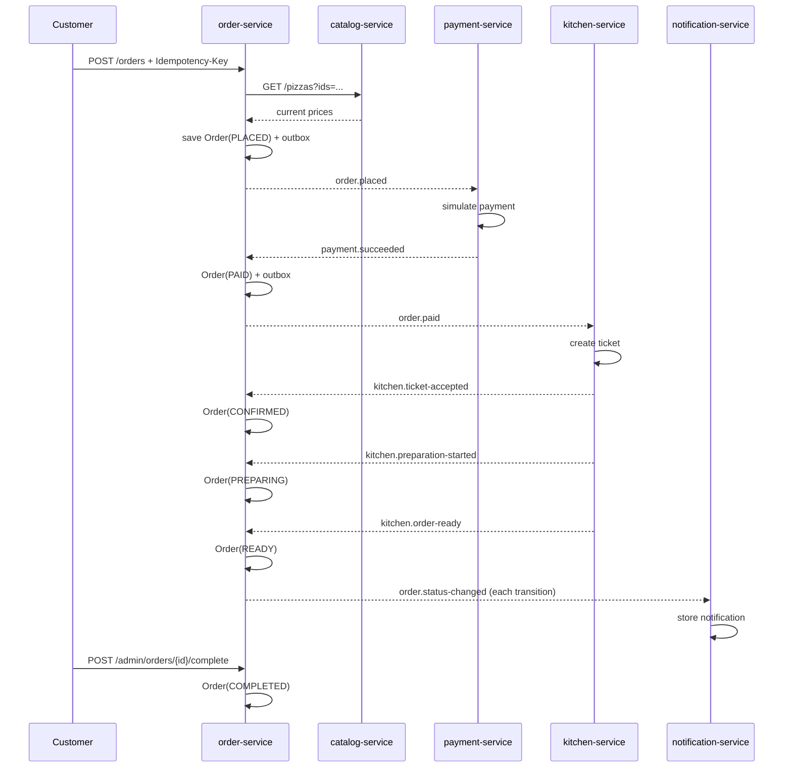

# Architecture

## Goals

The system is a backend for a pizza web shop with an event-driven order process. It demonstrates:

- REST APIs documented contract-first with OpenAPI.
- Hexagonal architecture with explicit inbound and outbound ports.
- Microservices with private data ownership.
- Reliable asynchronous integration through Kafka.
- Observable, testable services.

## Service boundaries

| Service | Owns | Publishes | Consumes |
|---|---|---|---|
| `catalog-service` | Pizzas, sizes, prices, availability | `catalog.events.v1` | — |
| `order-service` | Orders, status history, idempotency keys | `order.events.v1` | `payment.events.v1`, `kitchen.events.v1` |
| `payment-service` | Payments and refunds | `payment.events.v1` | `order.events.v1` |
| `kitchen-service` | Kitchen tickets and preparation deadlines | `kitchen.events.v1` | `order.events.v1` |
| `notification-service` | Simulated notification read model | — | `order.events.v1` |

Each service has its own logical database. No service reads another service's tables.

## Hexagonal layout

```
com.example.pizzashop.<service>
├── domain
│   ├── model          # Aggregates and value objects, no Spring or JPA
│   └── service        # Optional pure domain services
├── application
│   ├── port/in        # Use-case interfaces and commands
│   ├── port/out       # Repository, event publisher and client ports
│   └── service        # Transactional use-case implementations
├── adapter
│   ├── in/rest        # Implements generated OpenAPI interfaces
│   ├── in/kafka       # Kafka listeners
│   ├── out/persistence# JPA entities, Spring Data repositories, mappers
│   ├── out/messaging  # Outbox-backed event publishers
│   └── out/client     # REST client for catalog pricing
└── config
```

The domain layer contains no framework dependencies. JPA entities and generated OpenAPI models stay in adapters. Application services depend only on ports, the domain, shared contracts, and small shared infrastructure types.

## Event-driven order flow



### Why order-service owns the command stream

`payment-service` and `kitchen-service` do not consume each other's result events directly. Instead:

1. `payment-service` emits `payment.succeeded`/`payment.failed`.
2. `order-service` updates the order and publishes `order.paid` or `order.payment-failed`.
3. `kitchen-service` starts only after consuming `order.paid`.

All commands for one order travel through `order.events.v1`, keyed by `orderId`, so Kafka preserves their per-order order. This avoids races where the kitchen starts before the order state has been updated, while keeping the services decoupled.

### Cancellation and compensation

Cancellation is allowed in `PLACED`, `PAID`, and `CONFIRMED`. `order-service` publishes `order.cancelled` with a `wasPaid` flag. `payment-service` refunds a succeeded payment, and `kitchen-service` cancels a ticket that has not reached `READY`. Cancellation after preparation starts is rejected with HTTP 409.

## Data ownership and consistency

- Each service uses a private PostgreSQL database.
- Local development uses one PostgreSQL container with five databases; production should use separate instances.
- Cross-service consistency is eventual. The API exposes the current order state and a status history so clients can observe progress.
- There are no distributed transactions. The transactional outbox guarantees that committed domain changes eventually produce events, and the inbox makes consumers idempotent.
- Producer idempotence is enabled; consumers still deduplicate because Kafka delivery is at least once.

## Pricing

Order creation performs a synchronous read against the catalog. This keeps prices authoritative at checkout and avoids a stale catalog read model. The order snapshots the pizza name, size, unit price, quantity, and line total; later catalog price changes do not alter existing orders.

A future version could maintain a catalog read model from `catalog.events.v1`, but that would require an explicit freshness/availability policy for checkout.

## Reliability

- Outbox publisher: scheduled batch, `FOR UPDATE SKIP LOCKED`, synchronous send, retry with exponential backoff, failure tracking.
- Inbox: `processed_event` row inserted in the same transaction as side effects.
- Dead-letter topics: `<topic>.DLT`, with non-retryable events (malformed payloads, schema violations) routed immediately.
- Idempotency keys: `POST /orders` stores key, request hash, order ID, and expiry.
- Optimistic locking: `@Version` on order, payment, and kitchen ticket entities.
- Kitchen timers: deadlines are persisted in `kitchen_ticket.next_action_at` and processed by a scheduled poller, so restarts do not lose progress.

## Security

Authentication is intentionally out of scope for v1. Admin endpoints are namespaced under `/api/v1/admin` and documented as unsecured. Actuator exposes only health, info, and metrics. A production deployment should add an identity provider, service-to-service authentication, and network policies.
